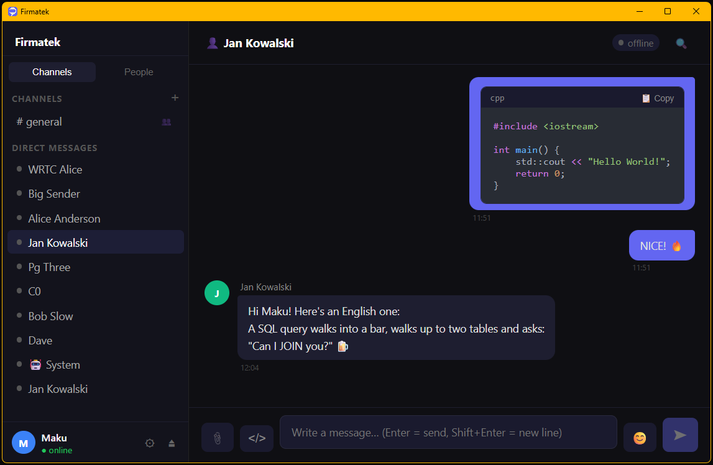

# Firmatek – Company Messenger

[](https://github.com/Maku-hub/Firmatek/actions/workflows/build.yml)
[](LICENSE)
[](https://github.com/Maku-hub/Firmatek/releases)

A desktop messenger for companies with chat, code snippets, screenshots and P2P file transfer.



## Features

- Group channels and direct messages (DM)
- Message search (Ctrl+F) – full-text search across all of the user's channels
- Code syntax highlighting (15+ languages, Shiki)
- P2P file transfer over WebRTC (no server load)
- Inline images (< 200 KB) over WebSocket
- Active Directory / LDAP integration
- CI/CD endpoint (`POST /api/notify`) for notifications from pipelines
- UI scaling (75–200%) – CSS zoom with a transform fallback
- Notification sound on new messages (Web Audio API)
- Single instance + minimize to the system tray
- Typing indicator

---

## Quick start

```bash
# Server
cp .env.example .env && nano .env
docker compose up -d

# Client (dev)
cd client && npm install && npm run tauri:dev

# Client (production)
cd client && npm install && npm run tauri:build
```

---

## Ports and firewall

### Server – ports that MUST be open

| Port | Protocol | Direction | Description |
|------|----------|-----------|-------------|
| 8080 | TCP | inbound | Main API + WebSocket port for clients |
| 443  | TCP | inbound | HTTPS via nginx (when using SSL) |
| 80   | TCP | inbound | HTTP → redirect to 443 (when using SSL) |

Command on a server with `firewalld` (Oracle Linux / RHEL):
```bash
firewall-cmd --permanent --add-port=8080/tcp
firewall-cmd --permanent --add-service=http
firewall-cmd --permanent --add-service=https
firewall-cmd --reload
```

On a server with `ufw` (Ubuntu / Debian):
```bash
ufw allow 8080/tcp
ufw allow 80/tcp
ufw allow 443/tcp
```

### Internal ports (do NOT expose publicly!)

By default these are bound only to `127.0.0.1` in docker-compose:

| Port | Service |
|------|---------|
| 5432 | PostgreSQL |
| 6379 | Redis |
| 9000 | MinIO API (optional – `storage` profile) |
| 9001 | MinIO Console (optional – `storage` profile) |

> **MinIO is optional.** By default `docker compose up -d` starts only PostgreSQL, Redis and the Go server.
> If you need an offline buffer (MinIO): `docker compose --profile storage up -d`

### Client – outbound ports

The client initiates outbound connections; it does not require any inbound ports to be opened on the client side.

| Port | Protocol | Description |
|------|----------|-------------|
| 8080 or 443 | TCP | Connection to the Firmatek server |
| Ephemeral UDP | UDP | WebRTC P2P (automatic through NAT) |

---

## Nginx as a reverse proxy with HTTPS

### Requirements

```bash
# Ubuntu/Debian
apt install nginx certbot python3-certbot-nginx

# Oracle Linux / RHEL
dnf install nginx certbot python3-certbot-nginx
```

### Step 1 – nginx configuration

Create `/etc/nginx/sites-available/firmatek` (Debian/Ubuntu)
or `/etc/nginx/conf.d/firmatek.conf` (RHEL/Oracle):

```nginx
# Redirect HTTP → HTTPS
server {
    listen 80;
    server_name firmatek.firma.local;
    return 301 https://$host$request_uri;
}

server {
    listen 443 ssl http2;
    server_name firmatek.firma.local;

    # SSL certificates (Let's Encrypt or your own)
    ssl_certificate     /etc/letsencrypt/live/firmatek.firma.local/fullchain.pem;
    ssl_certificate_key /etc/letsencrypt/live/firmatek.firma.local/privkey.pem;

    # Secure SSL settings
    ssl_protocols TLSv1.2 TLSv1.3;
    ssl_ciphers HIGH:!aNULL:!MD5;
    ssl_session_cache shared:SSL:10m;
    ssl_session_timeout 10m;

    # Proxy to the Go server
    location / {
        proxy_pass         http://127.0.0.1:8080;
        proxy_http_version 1.1;

        # Required for WebSocket
        proxy_set_header Upgrade    $http_upgrade;
        proxy_set_header Connection "upgrade";

        proxy_set_header Host              $host;
        proxy_set_header X-Real-IP         $remote_addr;
        proxy_set_header X-Forwarded-For   $proxy_add_x_forwarded_for;
        proxy_set_header X-Forwarded-Proto $scheme;

        # Long timeout for WebSocket (keeps the connection alive)
        proxy_read_timeout  3600s;
        proxy_send_timeout  3600s;

        # File upload size
        client_max_body_size 100M;
    }
}
```

### Step 2 – enable and obtain a certificate

```bash
# Debian/Ubuntu
ln -s /etc/nginx/sites-available/firmatek /etc/nginx/sites-enabled/

# Check the configuration
nginx -t

# Let's Encrypt (public domain)
certbot --nginx -d firmatek.firma.local

# Or a self-signed certificate (for an internal company network)
openssl req -x509 -nodes -days 3650 -newkey rsa:2048 \
  -keyout /etc/ssl/private/firmatek.key \
  -out /etc/ssl/certs/firmatek.crt \
  -subj "/CN=firmatek.firma.local/O=Company/C=PL"

# Start nginx
systemctl enable --now nginx
```

### Step 3 – update the server address in the client

In the app, enter the following in the "Server address" field:
```
https://firmatek.firma.local
```

---

## CI/CD – sending notifications

Firmatek has a dedicated endpoint for integration with pipelines.
It does not require a login – it uses a separate `NOTIFY_TOKEN` from `.env`.

The target channel must already exist on the server (the endpoint resolves it by
name or ID and returns 404 if it is not found).

### Configuration

Set in `.env`:
```
NOTIFY_TOKEN=your_secret_cicd_token
```

### Usage

#### curl
```bash
curl -X POST https://firmatek.firma.local/api/notify \
  -H "Content-Type: application/json" \
  -H "X-Notify-Token: your_secret_cicd_token" \
  -d '{
    "channel": "general",
    "title": "Deploy finished",
    "message": "Application deployed to production: v1.2.3",
    "level": "success",
    "footer": "Pipeline #142 | main | 2m 34s"
  }'
```

#### Python
```python
import requests

FIRMATEK_URL = "https://firmatek.firma.local"
NOTIFY_TOKEN = "your_secret_cicd_token"

def notify(channel: str, message: str, title: str = "", level: str = "info", footer: str = ""):
    resp = requests.post(
        f"{FIRMATEK_URL}/api/notify",
        headers={"X-Notify-Token": NOTIFY_TOKEN},
        json={"channel": channel, "message": message, "title": title, "level": level, "footer": footer},
        timeout=10,
    )
    resp.raise_for_status()
    return resp.json()

# Example usage in a pipeline
notify(
    channel="cicd",
    title="Deploy finished",
    message="Environment: production\nVersion: v1.2.3\nCommit: abc1234",
    level="success",
    footer=f"Pipeline #{pipeline_id} | {branch}"
)
```

#### GitLab CI (.gitlab-ci.yml)
```yaml
notify_success:
  stage: notify
  image: curlimages/curl:latest
  script:
    - |
      curl -s -X POST "$FIRMATEK_URL/api/notify" \
        -H "Content-Type: application/json" \
        -H "X-Notify-Token: $FIRMATEK_TOKEN" \
        -d "{
          \"channel\": \"cicd\",
          \"title\": \"Deploy $CI_PROJECT_NAME\",
          \"message\": \"Branch: $CI_COMMIT_REF_NAME\\nCommit: $CI_COMMIT_SHORT_SHA\\n$CI_COMMIT_MESSAGE\",
          \"level\": \"success\",
          \"footer\": \"Pipeline #$CI_PIPELINE_ID\"
        }"
  when: on_success
```

#### GitHub Actions
```yaml
- name: Notify Firmatek
  run: |
    curl -s -X POST "${{ secrets.FIRMATEK_URL }}/api/notify" \
      -H "Content-Type: application/json" \
      -H "X-Notify-Token: ${{ secrets.FIRMATEK_TOKEN }}" \
      -d '{
        "channel": "cicd",
        "title": "Build ${{ github.repository }}",
        "message": "Branch: ${{ github.ref_name }}\nCommit: ${{ github.sha }}",
        "level": "success",
        "footer": "Run #${{ github.run_number }}"
      }'
```

Levels (`level`): `info` | `success` | `warning` | `error`

---

## Active Directory / LDAP

In `.env`:
```
LDAP_ENABLED=true
LDAP_URL=ldap://dc.firma.local:389
LDAP_DOMAIN=firma.local
LDAP_BASE_DN=DC=firma,DC=local
LDAP_BIND_USER=svc_firmatek@firma.local
LDAP_BIND_PASSWORD=password
LDAP_USER_FILTER=(sAMAccountName=%s)
LDAP_TLS_SKIP_VERIFY=false
ENABLE_REGISTRATION=false
```

When `ENABLE_REGISTRATION=false`, the login screen does not show the "Register" tab.
With `LDAP_ENABLED=true` registration is always off, because every login is
checked against the directory and a local account could never sign in.
Set `LDAP_TLS_SKIP_VERIFY=true` only if your directory uses a self-signed
certificate. With `ldap://` the server attempts STARTTLS and, if it fails,
falls back to a plain connection.

---

## Optional services (compose profiles)

The core `docker compose up -d` runs PostgreSQL, Redis and the Go server. Two
optional services are available via profiles:

```bash
# TURN relay for WebRTC when both peers are behind strict NAT.
# Requires TURN_SECRET (and TURN_URLS on the server) in .env.
docker compose --profile turn up -d

# One-command TLS reverse proxy (Caddy) as an alternative to the manual nginx
# setup above. Serves FIRMATEK_DOMAIN with an internal (self-signed) cert.
docker compose --profile proxy up -d
```

Relevant `.env` settings (see `.env.example` for the full list):

| Variable | Purpose |
|----------|---------|
| `ALLOWED_ORIGINS` | Comma-separated CORS/WebSocket origins. Empty = allow all (dev). |
| `TRUSTED_PROXIES` | Proxy IPs/CIDRs whose `X-Forwarded-For` is honoured. Empty = use the TCP peer address. Set it when running behind Caddy/nginx, otherwise all users share the proxy's rate limit. |
| `DB_SSLMODE` | PostgreSQL `sslmode` (default `disable`, fine for the bundled container). |
| `TURN_SECRET` / `TURN_URLS` / `TURN_TTL` | Time-limited HMAC TURN credentials issued via `GET /api/turn-credentials`. |
| `TURN_REALM` | coturn realm (must match the client). |
| `FIRMATEK_DOMAIN` | Hostname served by the optional Caddy proxy. |

---

## API – message search

```
GET /api/messages/search?q=text&limit=50
Authorization: Bearer <JWT>
```

Searches messages across all of the user's channels. Parameters:
- `q` (required) – the phrase to search for (ILIKE + full-text search)
- `limit` (optional, default 50, max 200) – number of results

Returns an array of Message objects with an additional `channel_name` and `is_direct`.

---

## API – message history (pagination)

```
GET /api/channels/{channel_id}/messages?limit=50&before=<RFC3339>&before_id=<uuid>
Authorization: Bearer <JWT>
```

Returns a page of messages (ascending by time). Parameters:
- `limit` (optional, default 50, max 200) – page size
- `before` (optional) – return messages older than this timestamp;
  pass the oldest loaded message's `created_at` to load the previous page.
- `before_id` (optional) – that message's `id`; breaks ties between messages
  with the same timestamp so none are skipped at a page boundary.

The client shows a **"Load earlier messages"** button that uses this cursor.

---

## API – sessions

Tokens are valid for 24 hours. `POST /api/auth/refresh` (with a valid token)
returns `{token, user}` with a fresh token; the desktop client calls it on
start-up and every few hours, so people who leave the app open are not
signed out. A user may be connected from several devices at once; each
session receives every message.

## Message delivery

Every chat message carries a `client_id` (UUID) generated by the app. The
server answers the sending connection with `message_ack` (the stored message,
including `client_id`) or with an `error` whose payload names the
`client_id`. Until a message is acknowledged the app shows it as "Sending…";
it is resent after a reconnect and kept across restarts. Resending is safe:
a unique index on `(sender_id, client_id)` makes a repeat only re-acknowledge
the stored message, without storing or delivering it twice. Messages the
server rejected (too long, no access) are marked as not delivered and can be
retried or deleted by hand.

## Received files

In the desktop app, accepting a file first asks where to save it; the data is
then written to that file as it arrives and checked against a SHA-256
checksum computed by the sender while streaming. Memory use does not depend
on the file size. An interrupted, cancelled or corrupted transfer deletes the
partial file.

---

## Building installers

```bash
# Windows (.msi) – on Windows
cd client && npm install && npm run tauri:build

# Linux AppImage (all distributions) – via Docker
cd build-scripts
docker build -f Dockerfile.linux -t firmatek-linux ../
docker run --rm -v "$(pwd)/output:/output" firmatek-linux

# Debian .deb
docker build -f Dockerfile.debian -t firmatek-deb ../
docker run --rm -v "$(pwd)/output:/output" firmatek-deb

# Oracle Linux / RHEL .rpm
docker build -f Dockerfile.rpm -t firmatek-rpm ../
docker run --rm -v "$(pwd)/output:/output" firmatek-rpm
```

---

## Backup

All data lives in `./data/` – a single folder:
```bash
tar -czf backup-$(date +%Y%m%d).tar.gz data/
```
